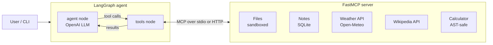

# MCP-Powered AI Assistant (FastMCP + LangGraph)


An AI assistant that uses the **Model Context Protocol (MCP)** to connect an LLM to real tools: a sandboxed file system, a persistent notes database, live web APIs and a safe calculator. The tools live in a standalone **FastMCP** server; the reasoning loop is a **LangGraph** state graph driven by the **OpenAI API**.

Because the tools sit behind MCP, the same server also works with any other MCP client, such as Claude Desktop or Cursor, with no code changes.

## Demo

```text
You: What's the weather in Mumbai, and save it as a note called "Mumbai weather"
→ tool get_weather {'city': 'Mumbai'}
→ tool add_note {'title': 'Mumbai weather', 'body': '29.4°C, 78% humidity, wind 14 km/h'}
╭─ Assistant ──────────────────────────────────────────────╮
│ It's 29.4°C in Mumbai with 78% humidity. Saved as note #1. │
╰──────────────────────────────────────────────────────────╯

You: Summarize project_ideas.md and tell me which one has the highest priority
→ tool read_file {'path': 'project_ideas.md'}
╭─ Assistant ──────────────────────────────────────────────╮
│ ... The Smart Study Planner is marked high priority.     │
╰──────────────────────────────────────────────────────────╯
```

## Architecture



1. On startup, `MCPToolBridge` connects to the MCP server, discovers every tool with its JSON schema, and wraps each one as a LangChain tool.
2. The LangGraph graph loops between the **agent** node (the LLM decides what to do) and the **tools** node (executes MCP calls) until the LLM produces a final answer.
3. Conversation memory is stored per thread with a LangGraph checkpointer, so follow-up questions work.

## Features

| Area | What it does |
|---|---|
| **MCP server** | 10 tools, 1 resource (`notes://all`) and 1 prompt (`summarize_file`) built with FastMCP |
| **Transports** | stdio (server auto-launched as a subprocess) and streamable HTTP |
| **Agent** | Explicit LangGraph `StateGraph` with conditional routing, multi-step tool chaining and memory |
| **Custom bridge** | Converts MCP tool schemas into LangChain tools; tool errors are returned to the LLM so it can recover |
| **Security** | Path-traversal protection on file tools, no-overwrite by default, AST-based calculator (no `eval`) |
| **Testing** | 10 offline pytest tests, including a full agent loop with a scripted fake LLM; CI on GitHub Actions |

### Tools

| Tool | Description |
|---|---|
| `list_files`, `read_file`, `write_file` | Work with files inside `workspace/` only |
| `add_note`, `search_notes`, `delete_note` | Persistent notes stored in SQLite |
| `get_weather` | Current weather for any city (Open-Meteo, no API key) |
| `wikipedia_summary` | Short summary of any topic |
| `calculate` | Safe arithmetic evaluation |
| `current_time` | Current UTC time |

## Quick start

```bash
git clone https://github.com/avishiii/mcp-ai-assistant.git
cd mcp-ai-assistant
python -m venv .venv
source .venv/bin/activate          # Windows: .venv\Scripts\activate
pip install -r requirements.txt
cp .env.example .env               # then add your OPENAI_API_KEY
python main.py
```

Other ways to run it:

```bash
python main.py --ask "What is 15% of 2480?"       # one-shot question
python main.py -v                                  # also print tool outputs

# Run the MCP server over HTTP and connect to it
python server/mcp_server.py --http 8000
python main.py --server http://127.0.0.1:8000/mcp
```

The default model is `gpt-4.1-mini`. Change it with `OPENAI_MODEL` in `.env` or `--model`.

### Use the server from Claude Desktop

Copy `claude_desktop_config.example.json` into your Claude Desktop config, update the path, and restart the app. The same tools become available there, which shows the point of MCP: one server, many clients.

## Tests

```bash
pip install -r requirements-dev.txt
pytest -q
```

Tests run fully offline (no OpenAI key, no network). They use FastMCP's in-memory transport and a scripted fake chat model to check tool discovery, file sandboxing, notes, calculator safety and the complete agent → tool → agent loop.

## Project structure

```
mcp-ai-assistant/
├── server/
│   └── mcp_server.py        # FastMCP server: tools, resource, prompt
├── agent/
│   ├── mcp_bridge.py        # MCP client -> LangChain tools adapter
│   └── graph.py             # LangGraph state graph (agent <-> tools loop)
├── tests/
│   └── test_assistant.py    # offline test suite
├── workspace/               # sandbox folder the assistant can read/write
├── main.py                  # interactive CLI
├── .github/workflows/tests.yml
└── requirements.txt
```

## Extending it

Add a new tool by writing a typed, documented function in `server/mcp_server.py`:

```python
@mcp.tool
def word_count(path: str) -> int:
    """Count the words in a workspace file."""
    return len(read_file(path).split())
```

The agent discovers it automatically on the next start.

## License

MIT
